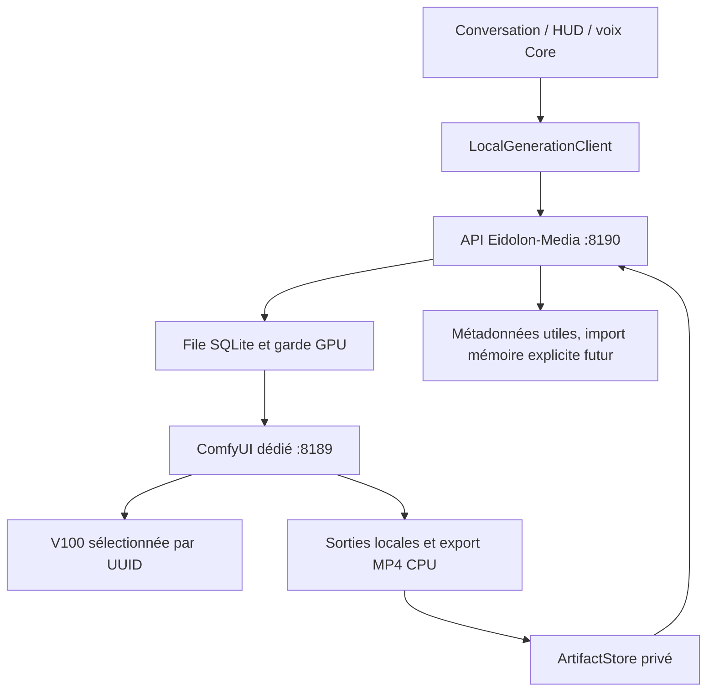

# Architecture et audit — G325

## Bases réellement examinées

| Dépôt / branche | Révision examinée | Constat |
| --- | --- | --- |
| Bootstrap `feat/eidolon-core-v0.1` | `62a0886454826231e13315e517affc56ee06e2f0` | Base de cette branche dédiée |
| Bootstrap `claude/video-generation-v100` | arbre lu à `1ec0250f4cc987ef38025f1a2411b125e01919e3` via API de parcours | Client et installateurs Wan2.2 existants, validation GPU absente du rapport du 23/10 |
| Memory `refactor/architecture-v1` | référence examinée `a5e2ab0a2d5be08e8f11b36af607b23407f57c28` via API de parcours | Architecture fichiers, index dérivés, écritures coordonnées ; aucune modification |
| Core installé sur X399 | `afb79a7da1e3cfcc0f8f9d58c3863b7ba2f3ef60` | Checkout distinct, annoncé en avance de 12 / retard de 1 avant fetch ; laissé intact |

Branches distantes inventoriées avec le connecteur GitHub. Lecture de AGENTS,
standard de présentation, ECHANGES, protocole de collaboration, G324 et C322,
architecture Core/Memory, documents MEDIA et sources correspondantes. La lecture
MCP du message GPT a échoué sur la synchronisation Git ; les fichiers ont été
lus directement sur GitHub. Cette panne n'a pas été « réparée » en modifiant le
checkout de production.

### Composants déjà présents, réutilisés

- `media_agents` : contrats et exceptions ; `media_http` : transport HTTP borné,
  sans proxy/redirection ; `media_backends.endpoint` : boucle locale littérale.
- `media_artifacts` : magasin privé, références opaques, empreintes et import
  atomique. `media_outputs.descriptors` : historique ComfyUI lié au graphe soumis.
- `media_worker`, `media_resources`, `gpu_queue` : files et réservations déjà
  présentes. Le worker historique est lié aux tickets/conversations Core et
  n'est pas un démon autonome de génération. Le garde média existant ne réserve
  pas les cartes contre tous les clients Ollama/Eva.
- `conversation_media`, `conversation_media_results`, interface web connectée,
  et HUD PySide6 : contrats/présentations existants, non remplacés.
- Branche vidéo Claude : travail préservé. Son installateur ajoute Manager et
  plusieurs extensions, écoute sur toutes les interfaces et propose un runtime
  différent. Il n'a pas été exécuté.

### État matériel vérifié

Debian **13.7**, noyau **6.12.113+deb13-amd64**, NVIDIA **550.163.01**.
Deux V100 SXM2 16 Go, compute capability 7.0, PCIe 3.0 ×4 chacune ; GTX1060 6 Go
également présente. NV6 actif, six liens par V100 ; compteurs CRC/Replay/Recovery
à zéro au contrôle final. Aucun nouveau benchmark P2P : les débits historiques
fournis par toytoy ne sont pas présentés comme remesurés.

PyTorch Eva observé : **2.6.0+cu124**, runtime CUDA **12.4**, `sm_70` présent.
Le champ CUDA de nvidia-smi décrit la capacité du pilote ; le runtime effectif
a été vérifié dans torch puis par les générations. Aucun toolkit système,
pilote ni environnement Eva n'a été remplacé. Python média 3.12.12, venv séparé ;
l'interpréteur de base provient de la distribution Python déjà présente, lue
sans modification. Les paquets du venv Eva ne sont pas partagés.

GPU initialement sans processus de calcul ; aucun entraînement Eva actif observé.
Core API, communication, monitor, tunnel mémoire, Ollama et Darme actifs avant et
après. VM `Memory-engine` active ; VM de tests et Minecraft éteintes à l'audit.
Aucune VM démarrée, arrêtée ou modifiée.

Capacités libres initiales : root 87 Gio, apps 181, data 227, models 93,
state 233, work 195, SSD 461. Après placement des poids : root environ 81 Gio,
models 67, data 227. Les poids n'occupent plus le volume système.

## Flux retenu

Seules les liaisons après la façade sont exercées dans cette recette. Le runtime
conversationnel de production n'est pas reconfiguré. La façade ne connaît ni
les nœuds ComfyUI ni CUDA : un futur moteur conserve le contrat HTTP.

La nouvelle file SQLite sert les demandes de cette API indépendante ; elle ne
remplace pas les tickets de conversation historiques. Un adaptateur vers leur
cycle d'accord/résultat reste à valider avant activation automatique depuis Core.

## Persistance et exécution

`WAITING → SUBMITTING → RUNNING → COLLECTING → SUCCEEDED`, avec `FAILED`,
`CANCEL_REQUESTED`, `CANCELLED` et `REVIEW_REQUIRED` distincts. L'intention est
persistée avant envoi. Après crash, un travail admis devient incertain et bloque
les nouvelles admissions ; aucun rejeu aveugle. L'annulation d'une tâche locale
en attente est immédiate ; celle d'un calcul exige un historique d'interruption.

Progression WebSocket par nœud (échantillonnage/décodage), **pas un pourcentage
global du temps**. L'historique confirmé et le décodage final font foi. Résultats
associés au SHA256 du graphe exécuté, puis copiés vers le magasin avec empreinte.
Les anciens résultats restent identifiables après déplacement sur le volume data.

## Deux GPU et NVLink

| Mode | Mécanisme nécessaire | Intérêt / coût | Validation dans ce lot |
| --- | --- | --- | --- |
| A, indépendants | Deux instances, UUID et ports distincts, ordonnanceur commun | Débit de plusieurs tâches ; poids dupliqués, consommation cumulée | Architecture étudiée, concurrence non benchmarkée |
| B, spécialisés | Affectation image/vidéo et réservation partagée avec Eva/Ollama | Isolation opérationnelle ; risque d'une carte inutilisée | Une instance sur GPU1 mesurée ; GPU0 laissé disponible |
| C, modèle réparti | Placement explicite de modules/tenseurs, backend compatible, mesure des copies | Modèles plus grands ; synchronisation, transferts, complexité | Non implémenté et non revendiqué |

ComfyUI voit **une** V100 grâce à CUDA_VISIBLE_DEVICES. Aucun partage automatique
des 32 Go actuels ni des 64 Go futurs. Pas de chemin NVLink utilisé/validé par
ces graphes monocar­te. Le PCIe ×4 pénalise potentiellement les rechargements CPU ;
NVLink ne remplace pas ce lien pour les chargements depuis RAM/disque.

Le garde relève les processus de calcul sur toutes les cartes, puis VRAM et
températures du GPU choisi. Un autre client fait différer l'admission ; s'il
apparaît pendant un travail, seule la génération média est invitée à s'arrêter.
Cela reste un contrôle coopératif avec une course temporelle, **pas une réservation
exclusive contre un client externe**. La production simultanée doit attendre
l'arbitrage commun avec Eva/Ollama. Aucune promesse de doublement du débit ou de
baisse de consommation : les mesures actuelles ne concernent qu'une carte.
